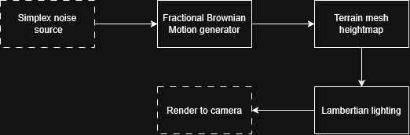

# Godot Terrain
Terrain generation and rendering in Godot.

## Project Goal
Useful for procedural terrain generation in games. Also allows for artist control through visual review and many options to change how terrain looks.

## How It Works

## Tech Stack
- Languages: GDScript, GLSL
- Game engine: Godot

## Setup & Usage
TBD

## Roadmap
- [ ] Colors, textures, shadows
- [ ] Erosion-based terrain generation
- [ ] Mesh simplification
- [ ] Collision detection
